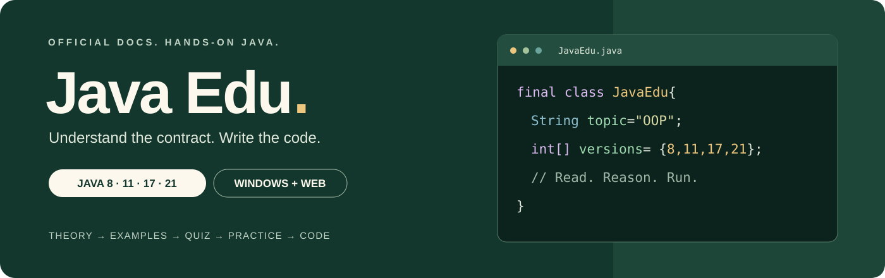
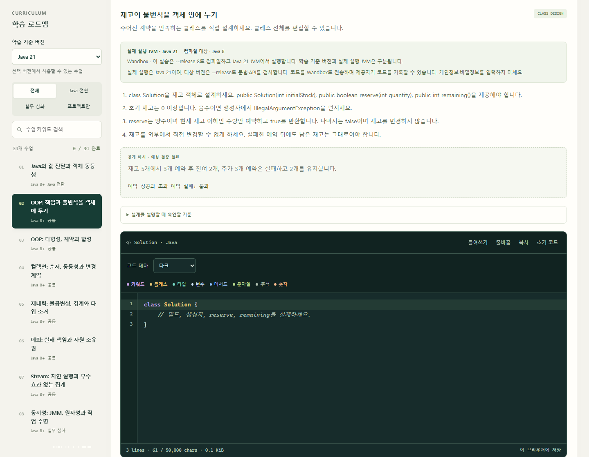

<div align="center">



# Java Edu

**공식 문서로 이해하고, 직접 코딩하며 배우는 Java.**

다른 언어 경험자의 Java 전환 학습부터 현직 개발자의 OOP·백엔드 심화까지.

[](https://github.com/jbsim999/java-edu/blob/feat/java-learning-mvp/docs/java-version-matrix.md) [](https://github.com/jbsim999/java-edu/blob/feat/java-learning-mvp/docs/installation.md) [](https://github.com/jbsim999/java-edu/blob/feat/java-learning-mvp/docs/education-roadmap.md) [](https://github.com/jbsim999/java-edu/issues) [](https://github.com/jbsim999/java-edu/actions/workflows/verify.yml?query=branch%3Afeat%2Fjava-learning-mvp)

[교육 로드맵](https://github.com/jbsim999/java-edu/blob/feat/java-learning-mvp/docs/education-roadmap.md) · [개발 소스](https://github.com/jbsim999/java-edu/tree/feat/java-learning-mvp) · [기여 안내](https://github.com/jbsim999/java-edu/blob/feat/java-learning-mvp/CONTRIBUTING.md) · [버그·제안](https://github.com/jbsim999/java-edu/issues)

</div>

## 소개

Java Edu는 **Windows·macOS에서 코드를 직접 실행하는 학습 앱과 웹 교재**를 함께 만드는 한국어 교육 프로젝트입니다. 다른 언어 경험자와 현직 Java 개발자가 “메서드에 객체를 넘겼는데 왜 결과가 달라질까?”, “트랜잭션을 붙였는데 왜 데이터가 남을까?” 같은 질문을 실제 코드로 확인하도록 돕습니다.

**macOS Intel·Apple Silicon 검증을 통과했습니다.** v0.4.0 검증용 DMG·ZIP에는 Java·Maven이 포함됩니다. macOS 13 Ventura 이상을 대상으로 하며, 실제 검증은 GitHub Actions의 macOS 15 Intel x64·Apple Silicon arm64에서 수행했습니다. [Mac 설치·빌드 안내](docs/macos-installation.md) · [실제 검증 결과](https://github.com/jbsim999/java-edu/actions/runs/38406992540)

수업은 **이론 → 예시 → 문제풀이 → 실무 심화 → 직접 코딩** 순서로 진행합니다. Java 언어·표준 API는 Oracle/OpenJDK 공식 문서를, 프레임워크·라이브러리는 각 프로젝트의 공식 문서를 기준으로 합니다. 실무 주제에는 출처를 기록한 채용 공고의 기술 요건도 연결합니다.

> **개발 상태** — 전체 34수업과 Windows 앱 소스는 `feat/java-learning-mvp` 브랜치에 있습니다. `main`은 프로젝트 소개를 제공합니다. [Windows v0.3.1 통합 프리뷰](https://github.com/jbsim999/java-edu/releases/tag/v0.3.1)를 설치해 학습할 수 있습니다. [호스팅 웹](https://java-edu-lab-jbsim999.junbo1218.chatgpt.site)은 소유자 전용이며 34수업·이론 도식 12개·편집기 테마가 배포돼 있습니다.

## 설치하고 시작하기

**Windows x64용입니다. 아래에서 하나만 다운로드하세요.**

**[설치 EXE 다운로드](https://github.com/jbsim999/java-edu/releases/download/v0.3.1/Java-Edu-Setup-0.3.1-x64.exe)** · **[설치 없이 사용하는 ZIP 다운로드](https://github.com/jbsim999/java-edu/releases/download/v0.3.1/Java-Edu-0.3.1-x64.zip)**

1. **EXE:** 다운로드한 파일을 실행해 설치한 뒤 **Java Edu**를 엽니다. **ZIP:** 폴더 전체를 압축 해제한 뒤 `Java Edu.exe`를 엽니다.
2. 앱에서 수업을 선택하고 **이론 → 예시 → 문제 → 실무 → 코드 실습** 순서로 진행합니다.
3. Spring 실습은 **환경 준비**를 한 번 진행한 뒤 코드를 작성하고 실행·제출합니다.

Java·Maven·Node.js가 포함돼 있어 따로 설치하거나 폴더를 등록할 필요가 없습니다. Spring 실습의 첫 환경 준비에는 인터넷이 필요합니다. ZIP 안의 EXE만 따로 옮기지 마세요.

[자세한 설치 안내](https://github.com/jbsim999/java-edu/blob/feat/java-learning-mvp/docs/installation.md) · [릴리스와 체크섬](https://github.com/jbsim999/java-edu/releases/tag/v0.3.1)

### macOS 설치 안내 — v0.4.0 검증용 빌드

Intel·Apple Silicon에서 DMG·ZIP 최종 앱 실행 검증을 모두 통과했습니다. Apple 메뉴 → 이 Mac에 관하여에서 **칩**이 Apple M 계열이면 `arm64`, **프로세서**가 Intel이면 `x64` 파일을 선택합니다.

| Mac | 검증용 파일 |
| --- | --- |
| Apple Silicon | [arm64 CI 산출물](https://github.com/jbsim999/java-edu/actions/runs/38406992540/artifacts/11818354876) |
| Intel | [x64 CI 산출물](https://github.com/jbsim999/java-edu/actions/runs/38406992540/artifacts/11819915823) |

CI 산출물 ZIP을 먼저 해제하면 `desktop-release/`에 해당 CPU의 DMG와 앱 ZIP이 있습니다. 검증 기록도 함께 포함되며 보존 기간은 생성 후 14일입니다. 정식 GitHub Release로 게시한 파일은 아닙니다. [패키지 SHA256·검증 범위](docs/macos-verification.md)

1. 자신의 CPU에 맞는 **DMG**를 열고 **Java Edu**를 **Applications**로 끌어 놓습니다.
2. 복사가 끝나면 디스크 이미지를 추출하고, 응용 프로그램에서 **Java Edu**를 엽니다. **ZIP**은 전체 `Java Edu.app`을 해제해 응용 프로그램으로 옮깁니다.
3. 첫 코드 실습에서 실행에 동의합니다. 포함 JDK 21·Maven 3.10.0을 사용하며, Spring의 첫 환경 준비에는 인터넷이 필요합니다.

Mac 프리뷰는 Apple Developer ID 서명·공증을 제공하지 않습니다. 최초 실행이 차단되면 출처와 체크섬을 확인한 후 Apple의 [개별 앱 실행 안내](https://support.apple.com/102445)를 따릅니다. 실제 다운로드·Gatekeeper 흐름은 CI 실행 검증과 별도입니다. [자세한 Mac 안내](docs/macos-installation.md)

## 학습실 미리보기



*개발 중인 공용 학습실의 실제 로컬 웹 화면입니다. 화면 캡처를 실행·제출 성공 근거로 사용하지 않습니다.*

## 주요 기능

| 기능 | 학습 경험 |
| --- | --- |
| 공식 문서 기반 과정 | Java 8·11·17·21의 언어·API 차이와 공식 출처 확인 |
| 깊이 있는 OOP | 객체의 책임·불변식, 다형성·합성, 동등성·변경 계약 탐구 |
| 실제 코드로 이해하기 | 34수업의 상황·용어·원문 코드·값 변화·결과 예측 해설 |
| 넓은 수업 본문 | 반복 안내는 펼쳐 보고, 화면 크기에 맞춰 본문과 코드 폭 확보 |
| 검수한 이론 도식 | 참조·상태·호출·보안 조건을 설명하는 12개 도식과 공식 참고자료 |
| 직접 코딩 | 클래스 골격, 메서드 본문, 다중 파일 프로젝트에 코드 작성 |
| 읽기 쉬운 편집기 | 클래스·타입·변수·메서드 문법 색상, 다크·라이트·고대비 테마 |
| 로컬 Java 실행 | 별도 설치 없이 포함된 JDK 21로 컴파일·실행·제출·취소 |
| 실무 프로젝트 | Spring/H2·REST·MyBatis·JPA·보안 과제를 고정 테스트로 확인 |
| 이어서 학습 | 진도·메모·코드 초안·테마 저장 및 앱 재시작 후 복원 |

## 교육 과정

**Java 코어 12수업 + 실무 22수업 · 개념 문제 68문항 · 코딩 과제 34개**

| 과정 | 주요 주제 |
| --- | --- |
| Java 사고 모델 | 값 전달·객체 동등성, OOP·불변식·다형성·합성 |
| 언어와 표준 API | 컬렉션·제네릭·예외·Stream·날짜/시간, 동시성, 최신 Java |
| 빌드와 테스트 | Maven, JUnit, AssertJ, Mockito, Lombok |
| Spring과 HTTP | DI·AOP, MVC·REST, JSON·입력 검증 |
| 데이터와 일관성 | JDBC·MyBatis·JPA, Flyway, 트랜잭션·동시 수정 |
| 보안과 운영 | CSRF, OAuth2/OIDC의 인증 주체, JWT 검증, 관측·빌드/배포 비교 |
| 선택 과정과 캡스톤 | Redis 캐시, Kafka 멱등성, 주문 API 통합 프로젝트 |

기본 실무 20프로젝트는 H2·로컬 테스트를 사용합니다. Redis/Kafka 두 단원은 별도 선택 환경이며 실제 서비스 연동은 아직 검증하지 않았습니다. OIDC 수업은 인증 주체 처리에 집중하고 전체 로그인 프로토콜 구현은 다루지 않습니다. [전체 로드맵](https://github.com/jbsim999/java-edu/blob/feat/java-learning-mvp/docs/education-roadmap.md) · [실무 과정 상세](https://github.com/jbsim999/java-edu/blob/feat/java-learning-mvp/docs/professional-curriculum.md)

## 개발 소스로 실행하기

**개발 소스 실행:** Node.js 22 이상이 필요합니다.

```sh
git clone --branch feat/java-learning-mvp https://github.com/jbsim999/java-edu.git
cd java-edu
npm ci
```

**웹 교재 실행**

```sh
npm run dev
```

브라우저에서 `http://127.0.0.1:4173`을 엽니다. 실무 코드는 웹에서 편집하고 프로젝트 ZIP을 내려받을 수 있습니다. Spring 프로젝트 실행은 Windows·macOS 앱 또는 로컬 IDE에서 진행합니다.

**Windows 학습 앱 실행**

```sh
npm run desktop
```

개발 실행에 번들을 준비하지 않았다면 앱에서 자신의 JDK/Maven을 등록합니다. 배포 패키지는 도구를 자동 등록하며, 학습 코드 실행에는 명시적인 동의가 필요합니다. 실무 과제는 **환경 준비 → 파일 편집 → 실행·제출** 순서로 진행합니다. [Windows 사용 안내](https://github.com/jbsim999/java-edu/blob/feat/java-learning-mvp/docs/installation.md)

<details>
<summary><strong>Windows 설치 파일 직접 빌드</strong></summary>

```sh
node scripts/bundle-runtime.mjs --jdk21 <JDK21-폴더> --maven <Maven3-폴더> --metadata desktop/toolchain-provenance.json
npm run check:bundle
npm run build:desktop
```

공식 원본 ZIP의 체크섬을 대조하고 전체 배포 폴더를 준비한 뒤 빌드합니다. `desktop-release/`에 Windows x64 NSIS 설치 EXE와 전체 ZIP을 생성합니다. 직접 재빌드한 파일은 배포 파일과 별도로 검증해야 합니다. [번들·출처·대응 소스 계약](https://github.com/jbsim999/java-edu/blob/feat/java-learning-mvp/docs/bundled-runtime.md) · [배포 파일과 SHA-256](https://github.com/jbsim999/java-edu/releases/tag/v0.3.1)

</details>

<details>
<summary><strong>macOS 설치 파일 직접 빌드</strong></summary>

macOS 13 이상, Node.js 22.12 이상에서 해당 CPU의 Mac으로 빌드합니다. Mac 구현은 `codex/macos-packaging` 브랜치에 있습니다. 위에서 저장소를 내려받았다면 먼저 브랜치를 전환합니다.

```sh
git switch codex/macos-packaging
npm ci
npm run prepare:mac
npm run check:bundle
npm run build:desktop:mac -- --arm64
# Intel Mac에서는 --arm64 대신 --x64를 사용합니다.
```

공식 macOS JDK·Maven 아카이브의 고정 SHA256을 확인하고 전체 배포본을 포함합니다. `desktop-release/`에 `Java-Edu-0.4.0-mac-arm64.dmg` 또는 `Java-Edu-0.4.0-mac-x64.dmg`와 해당 ZIP을 생성합니다. 기존 스테이징 결과를 덮어쓰지 않습니다. 최종 패키지 자동 검사는 개인 학습 기록을 보호하기 위해 일회용 macOS CI에서 수행합니다. [빌드·실행 경계](docs/macos-installation.md) · [검증 기록](docs/macos-verification.md)

</details>

### 실행 방식과 버전

| 구분 | Windows·macOS 앱 | 웹 교재 |
| --- | --- | --- |
| Java 코어 | 기본 포함 JVM 21, 컴파일 대상 8·11·17·21; 다른 실제 JDK는 선택 등록 | Wandbox의 JVM 21, 과제별 최소 지원 버전으로 컴파일 |
| Spring 프로젝트 | 컴파일 대상 17, 포함 JDK 21·Maven 3.10.0 사용 | 교재·파일 편집·ZIP 다운로드 |
| 코드 전송 | 작성 코드를 Wandbox로 전송하지 않음 | 코어 실행·제출 시 Wandbox로 전송 |
| 학습 기록 | 앱 데이터에 저장 | 해당 브라우저에 저장 |

웹과 앱 간 자동 동기화는 제공하지 않습니다. 실무 첫 환경 준비에는 앱 내부의 의존성 다운로드가 필요하며, 처음부터 모든 실무가 완전 오프라인인 패키지는 아닙니다. 실제 JDK 8·11·17 추가 등록은 고급 설정의 선택 기능입니다. [로컬 실행 계약](https://github.com/jbsim999/java-edu/blob/feat/java-learning-mvp/docs/local-execution.md)

## 개발과 검증

| 명령 | 목적 |
| --- | --- |
| `npm run check` | 콘텐츠·API·구문 정합성 검사 |
| `npm run test:java` | 설치된 JDK의 Java 예제·답안 검사 |
| `npm run test:local` | 로컬 실행·Windows 프로세스 종료 계약 검사 |
| `npm run test:professional` | JDK/Maven에서 실무 기준 구현과 미완성 코드 비교 |
| `npm run test:browser` | 실행 중인 로컬 서버의 모의 API 브라우저 검사 |
| `npm run test:theory` | 이론 도식·원문 보존·키보드·반응형 검사 |
| `npm run build` / `npm run test:worker` | 웹 Worker 빌드·산출물 검사 |
| `npm run prepare:mac` / `npm run build:desktop:mac` | Mac 공식 포함 도구 준비·네이티브 DMG/ZIP 빌드 |
| `node scripts/verify-macos-packages.mjs --arch arm64` 또는 `x64` | 일회용 Mac CI에서 최종 패키지·실제 앱 실행·Java/Spring 제출·재시작 저장 검사 |

실무 검사는 `JAVA_HOME`·`MAVEN_HOME` 설정이 필요합니다. 기본 검사는 Redis/Kafka를 제외합니다. 브라우저 검사는 실행 제공자의 실제 동작 검증과 구분합니다.

2026-10-13 기준, v0.3.1 앱 소스 `6ce0428`의 [CI 12작업](https://github.com/jbsim999/java-edu/actions/runs/38338837092)이 모두 성공했습니다. 독립 검수에서 읽기 안내 **24/24**, 기존 기능 **49/49**, 도식 **19/19**, 정적 검사 **5/5**가 통과했고 새 EXE·ZIP의 전체 파일과 포함 도구 604개를 대조했습니다. 사용 중인 앱과 학습 기록을 보존하기 위해 **신버전의 실제 설치·기동 검사는 미실행**입니다. 이전 v0.3.0 설치·제거 검증과 구분합니다. [이번 검증 범위](https://github.com/jbsim999/java-edu/blob/feat/java-learning-mvp/docs/readability-release-qa-report.md) · [검증 기록](https://github.com/jbsim999/java-edu/blob/feat/java-learning-mvp/docs/verification.md)

2026-10-13, 소스 `1f93d9e`의 [Mac 패키지 CI](https://github.com/jbsim999/java-edu/actions/runs/38406992540)가 **Intel·Apple Silicon·Windows 회귀 3작업 모두 성공**했습니다. 두 Mac에서 콘텐츠40 PASS/원격 제공자1 SKIP, 로컬32 PASS/Windows 전용1 SKIP를 확인했습니다. CPU별 DMG·ZIP 총 4개의 포함 도구 무결성·서명·소스 동일성과 실제 앱의 Java8/21 대상 제출·Spring/H2 환경 준비·정답/미완성 판정·재시작 저장이 통과했습니다. 포함 JVM은 21이며 실제 JDK8 실행 검증과 구분합니다. Apple Developer ID 공증·다운로드 후 Gatekeeper·개인 Mac 사용 검증은 미실행입니다. [Mac 검증 기록과 체크섬](docs/macos-verification.md)

## 문서와 로드맵

| 찾는 내용 | 문서 |
| --- | --- |
| 서비스의 목표와 학습 대상 | [기획안](https://github.com/jbsim999/java-edu/blob/feat/java-learning-mvp/docs/product-plan.md) |
| 학습 순서와 Java 버전 | [교육 로드맵](https://github.com/jbsim999/java-edu/blob/feat/java-learning-mvp/docs/education-roadmap.md) · [호환 기준](https://github.com/jbsim999/java-edu/blob/feat/java-learning-mvp/docs/java-version-matrix.md) |
| 코어·실무 교재 | [Java 코어](https://github.com/jbsim999/java-edu/blob/feat/java-learning-mvp/docs/curriculum.md) · [실무 22단원](https://github.com/jbsim999/java-edu/blob/feat/java-learning-mvp/docs/professional-curriculum.md) |
| 이론 도식의 선정과 검수 | [34수업 평가·12개 채택 근거](https://github.com/jbsim999/java-edu/blob/feat/java-learning-mvp/docs/theory-visuals.md) · [독립 QA](https://github.com/jbsim999/java-edu/blob/feat/java-learning-mvp/docs/theory-visual-qa-report.md) |
| 채용 공고 조사 근거 | [출처·표본·조사 범위](https://github.com/jbsim999/java-edu/blob/feat/java-learning-mvp/docs/job-evidence.md) |
| 구조와 실행 경계 | [아키텍처](https://github.com/jbsim999/java-edu/blob/feat/java-learning-mvp/docs/architecture.md) |
| 통합 ZIP·설치 앱 검증 | [번들 QA](https://github.com/jbsim999/java-edu/blob/feat/java-learning-mvp/docs/bundled-desktop-qa-report.md) · [이전 0.2 설치 QA](https://github.com/jbsim999/java-edu/blob/feat/java-learning-mvp/docs/installed-desktop-qa-report.md) |
| 현재 작업·출시 상태 | [마일스톤](https://github.com/jbsim999/java-edu/blob/feat/java-learning-mvp/docs/milestones.md) · [개발 인계](https://github.com/jbsim999/java-edu/blob/feat/java-learning-mvp/docs/development-handoff.md) |
| macOS 설치·빌드·검증 | [Mac 안내](docs/macos-installation.md) · [Mac 검증 상태](docs/macos-verification.md) |

- [x] Java 코어 12수업과 직접 코딩 과제
- [x] Java 문법 강조·3테마·다중 파일 편집
- [x] Windows 로컬 JDK/Maven 실행과 진도 저장 구현
- [x] 실무 22수업과 기본 20프로젝트의 기준 검증
- [x] 이론 도식 12개와 공식 출처·텍스트 설명
- [x] Windows CI·설치/제거 검증·최종 시각 검수
- [x] 34수업·이론 도식 웹 교재 배포
- [x] Java·Maven 포함 Windows EXE와 전체 ZIP 패키징
- [x] [Windows v0.3.1 통합 프리뷰 릴리스](https://github.com/jbsim999/java-edu/releases/tag/v0.3.1)
- [ ] 선택 과정의 Redis/Kafka 실제 연동 검증
- [x] macOS Intel·Apple Silicon 최종 DMG/ZIP 빌드와 실제 앱 실행 검증

## 기여와 문의

교육 내용의 오류, 공식 문서와 다른 설명, 실행 문제와 개선 아이디어는 [Issues](https://github.com/jbsim999/java-edu/issues)에 남겨 주세요. 실행 문제는 OS·JDK·Maven 버전, 단원, 재현 순서와 오류 메시지를 포함하면 확인에 도움이 됩니다.

기여 전 [CONTRIBUTING](https://github.com/jbsim999/java-edu/blob/feat/java-learning-mvp/CONTRIBUTING.md)을 읽어 주세요. 공식 출처와 버전별 근거를 함께 기록하고 실제 실행한 검사와 미검증 범위를 구분합니다. 유지관리자: [jbsim999](https://github.com/jbsim999).

## 라이선스

프로젝트 코드·교재의 라이선스는 아직 지정하지 않았습니다. 편집기·JDK·Maven과 포함된 제3자 구성 요소의 고지를 원본대로 보존하며 각 조건을 따릅니다. 대응 JDK·빌드·제3자 소스도 같은 릴리스에서 제공합니다. 학습자는 EXE 또는 ZIP 하나만 받으면 됩니다. [출처와 소스](https://github.com/jbsim999/java-edu/blob/feat/java-learning-mvp/docs/bundled-runtime.md)
